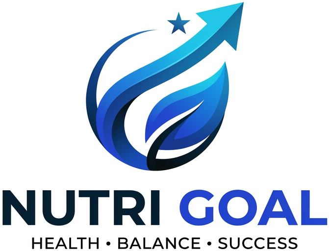

<p align="center"></p>

# NutriGoal

**Nutrition answers, by the ticket.** Members build a health profile, send one nutrition goal at a time, and a licensed physician (MD) or registered dietitian (RD) writes back a response ticket: a concise recommendation followed by 5–6 actionable steps, each with a timeframe, within 48 hours.

Product strategy, market sizing and pricing research live in [`Ticket-Based Nutrition App.pptx`](./Ticket-Based%20Nutrition%20App.pptx).

---

## What's built

### Member experience
| Area | What it does |
| --- | --- |
| **Sign up & two onboarding paths** | **1. Enter health data:** age, sex, height, weight, body fat % (or estimated), meals/day, estimated calories, workout minutes/day, goal weight, goal body fat and a timeframe the platform checks is safe. **2. Upload a checkup report** (PDF/photo): text PDFs are read on the server, values are shown back, then pre-filled for confirmation and extra details. |
| **Animated character build** | The physical build is a cartoon character shaped by height, lean mass and body fat, in the member's chosen **skin tone** and hair. It breathes and blinks; a **Today ↔ Goal** toggle, slider and "Play transformation" morph it toward the goal body, with a dotted outline and a side-by-side Today vs Goal comparison. |
| **Photo body scan (optional)** | Take a photo with the camera or upload one. Skin tone is sampled **in the browser** (tap your cheek or forearm). With consent, the photo can be sent once to Claude for a rough body-fat range; it is never saved. |
| **Biometric card** | BMI, body fat, lean/fat mass, BMR, TDEE, calorie target, protein, water, per-meal calories, timeline, labs and clinician flags. |
| **Goal tickets + voice mode** | Goal type, goal, typical diet, setbacks, target. **Voice mode:** speak the whole ticket and it's sorted into the fields (Claude when configured, keyword rules otherwise), or tap the mic on any single field. |
| **Split-screen submit** | Option 1: one-time ticket **$19.99**. Option 2: Membership **$29.99/month** or **$300/year** (1 ticket/month + Daily Support Pack + $14.99 extra tickets). |
| **Payments: Stripe + proof of payment** | With Stripe keys set, every purchase goes through **Stripe Checkout** (one-time and subscriptions) and returns to a **proof-of-payment receipt** with the Stripe payment ID and a link to Stripe's own receipt. Without keys, a demo checkout runs the same flow. |
| **Membership tab** | **Overview:** plan, the member's build, daily calorie and macro targets, payments and receipts. **Progress:** weigh-in log, weight chart vs. the safe path to goal (hover for details), stats and history. **Settings (MyFitnessPal-style):** character, goals and weekly rate, custom calories, macro split, units (lb/kg, kcal/kJ, oz/ml), meal names, weigh-in reminders, nudges and quiet hours, notification channels, privacy, assistant and voice toggles. |
| **Marketplace** | **Top 3 U.S. supermarket grocers** (Kroger, Albertsons, Publix), **food retailers** (Walmart, Costco, Amazon Fresh & Whole Foods) and **retail pharmacies** (CVS, Walgreens, Walmart Pharmacy) as public listings, clearly marked as not NutriGoal partners. Plus verified partners (grocers, retailers, pharmacies, fitness coaches) and unlockable add-ons. Available with or without a ticket. |
| **NutriGoal Assistant (AI)** | A chat widget on every member page. It searches the marketplace, saves stores, lists and unlocks add-ons (paid ones always go through the member's own checkout), checks ticket status and **nudges the assigned clinician** (rate-limited to once per 6 hours per ticket). It never gives medical advice; it points members to goal tickets instead. |
| **Mobile version** | Responsive on phones with a bottom tab bar, a floating assistant button, and an installable app (web manifest, home-screen icons, offline screen). |

### Staff experience (clinicians and managers)
- **Routing by plain rules (no AI):** goal group = medication stage × goal type → physician or dietitian, then specialty match and shortest queue.
- **Queue** with 48-hour SLA, due-soon flags and **⚑ Nudged ×N** badges.
- **Ticket review:** member ticket, routing reason, the member's animated build + biometric card, reports, care-team notes, nudge history.
- **Response composer with voice mode:** dictate the whole response and it's formatted into a recommendation + 5–6 timed steps for the clinician to review and sign. When Claude does the formatting, the "AI writing help: wording only" disclosure is set automatically. Only the assigned clinician can sign.
- **Manager operations:** KPIs, clinician load, reassignment, **send a nudge**, roster.

---

## Run it locally

```bash
export PATH="$HOME/.local/bin:$PATH"   # Node 22 installed for this project
npm install
npm run dev
```

Open http://localhost:3000. The SQLite database and uploads are created in `data/` and seeded on first run; schema migrations apply automatically. `npm run db:reset` starts fresh.

### Turn on the integrations (optional)
Copy `.env.example` to `.env.local`, fill in what you need, and restart `npm run dev`.

| Key | Enables |
| --- | --- |
| `ANTHROPIC_API_KEY` | AI assistant, voice-mode formatting, photo body-fat estimates. Uses **Claude Opus 5.5** (`claude-opus-5-5`) through the Messages API with server-side refusal fallbacks (`fallbacks: "default"`). Without it, the assistant and voice mode use keyword rules. |
| `STRIPE_SECRET_KEY` | Real Stripe Checkout for tickets, memberships and add-ons, with proof-of-payment receipts. Use a **test-mode** key (`sk_test_…`). |
| `STRIPE_WEBHOOK_SECRET` | Webhook fulfilment and membership renewals. Locally: `stripe listen --forward-to localhost:3000/api/stripe/webhook`. |

Stripe test card: `4242 4242 4242 4242`, any future expiry, any CVC.

### Demo accounts (local seed data only)
Every seeded account uses the password **`NutriGoal-demo-2026`** (see [`src/lib/seed.ts`](src/lib/seed.ts)).

| Role | Email |
| --- | --- |
| Member (responded ticket, progress history) | `member@nutrigoal.test` |
| Member (subscriber, type 2 diabetes) | `priya.shah@nutrigoal.test` |
| Physician, obesity medicine | `dr.okafor@nutrigoal.test` |
| Physician, internal medicine | `dr.grant@nutrigoal.test` |
| Dietitian, RD LDN | `marcus.lee@nutrigoal.test` |
| Dietitian, RD CDCES | `elena.ruiz@nutrigoal.test` |
| Operations manager | `manager@nutrigoal.test` |

Demo checkout (no Stripe key): `4242 4242 4242 4242` succeeds, `4000 0000 0000 0002` declines.

---

## Host a public demo (Railway)

NutriGoal needs a running Node server and a disk for its SQLite database, so it can't run on GitHub Pages.

1. In Railway: **New Project → Deploy from GitHub repo → StephenAsanteJr/NutriGoal**. It builds with `npm run build` and starts with `npm start` (Node 22, from `.nvmrc`).
2. Add a **Volume** to the service, mounted at `/data`.
3. Add the variable `NUTRIGOAL_DATA_DIR=/data` so the database, uploaded reports and session secret survive redeploys. Optional: `APP_URL` (your public URL, for Stripe redirects), Stripe test-mode keys, and `ANTHROPIC_API_KEY` (leave it unset on a public demo unless you accept the usage cost; without it the assistant and voice mode use keyword rules).
4. **Settings → Networking → Generate Domain** to get the shareable link.

A "demo site" banner shows by default; set `NUTRIGOAL_DEMO_BANNER=off` to hide it. The seeded demo logins below also work on a hosted copy, so anyone with the link can sign in as staff: never enter real health information in a public demo.

## Tech stack
- **Next.js 16** (App Router, Server Actions, Turbopack) · **React 19** · **TypeScript** · **Tailwind CSS 4**
- **SQLite** (`better-sqlite3`) with versioned migrations (`src/lib/migrations.ts`)
- **Claude** via `@anthropic-ai/sdk` (tool runner for the assistant; structured outputs for voice and scans)
- **Stripe** via the official `stripe` SDK (Checkout Sessions, webhooks)
- Auth: bcrypt + signed HTTP-only JWT cookie (`jose`) · PDF text: `unpdf`

```
src/
  actions/     auth, profile + report upload, tickets + checkout, settings + weigh-ins, staff, marketplace
  app/         landing, (auth), (member) dashboard/onboarding/tickets/marketplace/membership/payments, staff/*,
               api/{assistant,voice,scan,reports,stripe/webhook}, payments/complete, manifest
  components/  AvatarBuild (animated character), BiometricCard, BuildPanel, PhotoScan, Voice, Assistant,
               ProgressChart, MobileNav, ResponseTicket, LookPicker, Logo
  lib/         biometrics, silhouette, routing, nudges, ai, agent, stripe, fulfillment, payments (demo),
               report-extract, voice-fallback, migrations, db + seed
```

---

## Not production-ready yet: next steps
1. **Compliance:** HIPAA-eligible hosting and BAAs (including any AI vendor you use with PHI), encryption at rest for `data/uploads`, audit log review, MFA for staff, staff invitations instead of seeded accounts.
2. **Stripe:** customer portal for cancelling or updating cards; tie subscription status to Stripe events beyond renewals.
3. **Notifications:** deliver nudges, reminders and response tickets by email/SMS/push (settings are stored; sending isn't wired).
4. **Marketplace:** real partner onboarding, verification workflow, and affiliate tracking with disclosure; store-specific cart building for saved stores.
5. **Ticket follow-up:** the included follow-up question and "suggest goal 2" (deck slides 8 and 25).
